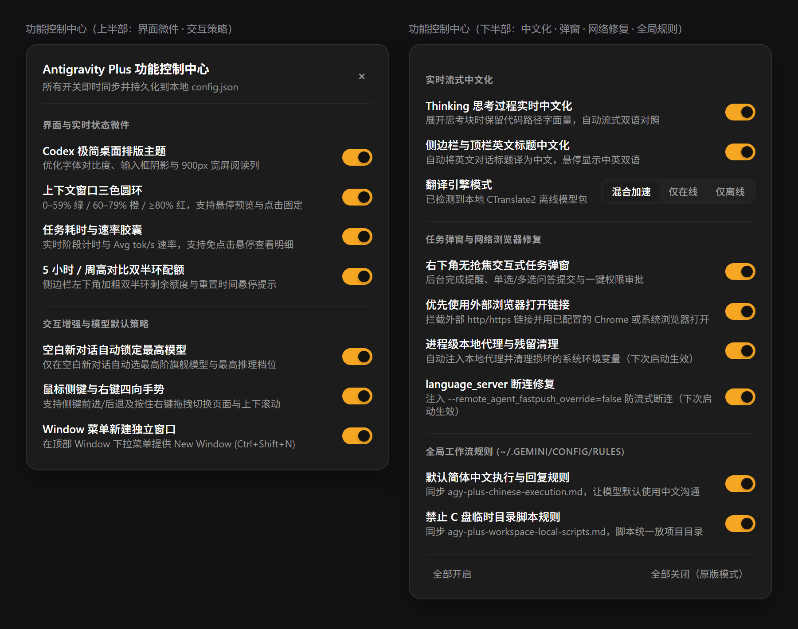
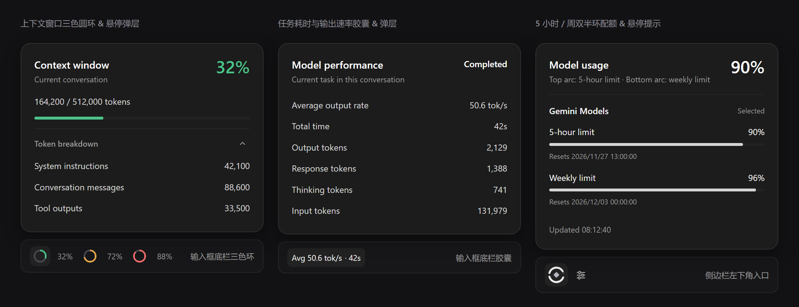
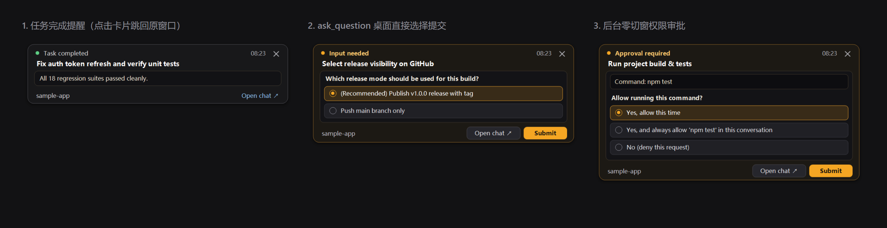

# Antigravity Plus (`antigravity-plus`)

<p>
  
  
  
  
  
</p>

面向 **Google Antigravity (Windows)** 的模块化增强套件。采用 **0 字节无损原生引导层（Shim V3）** 架构，在不解包或破坏官方 `app.asar` 归档与签名的前提下，一站式集成极简桌面主题、三大实时状态微件、新对话最高旗舰模型自动锁定、鼠标侧键与四向右键手势、`Thinking` 与对话标题流式中文化、右下角无抢焦交互式任务通知 / 一键权限审批，以及进程级网络与外部浏览器路由修复。

> **全部 15 项功能与 3 种翻译模式均支持随时独立开启或关闭**，可视化控制中心毫秒级实时生效，卸载可 100% 无损恢复官方原版。

---

## 一、核心界面与模块预览

> 以下预览均基于仓库真实 CSS/DOM 样式与原生 `TaskToastHost.exe` 实景渲染（使用虚构示例数据）。

### 功能控制中心（全部 15 项模块实时热开关）


### 三大实时状态微件（三色上下文环 · 性能速率胶囊 · 双半环配额）


### 右下角原生交互通知中心（`TaskToastHost.exe` 实景渲染）


---

## 二、功能模块一览

> 所有模块安装后默认开启，均可在客户端设置面板（`Ctrl + Shift + ,`）或 `Manage.cmd` 中随时单独关闭。

### 界面与实时状态微件

<table>
  <thead>
    <tr>
      <th width="28%" align="left">模块与配置键 (<code>features.*</code>)</th>
      <th width="16%" align="center">生效方式</th>
      <th width="56%" align="left">核心能力说明</th>
    </tr>
  </thead>
  <tbody>
    <tr>
      <td><strong>Codex 极简桌面主题</strong><br/><code>codexTheme</code></td>
      <td align="center"><code>0ms 即时</code></td>
      <td>ChatGPT / Codex 极简桌面排版主题、高对比度代码块、精致输入框阴影与 900px 宽屏阅读列</td>
    </tr>
    <tr>
      <td><strong>上下文窗口三色圆环</strong><br/><code>contextRing</code></td>
      <td align="center"><code>0ms 即时</code></td>
      <td>输入框右下角三色圆环（0–59% 翠绿 / 60–79% 琥珀橙 / ≥80% 珊瑚红），免点击悬停预览（140ms 跨缝缓冲）、点击固定与 <code>Token breakdown</code> 明细</td>
    </tr>
    <tr>
      <td><strong>任务耗时与速率胶囊</strong><br/><code>performancePill</code></td>
      <td align="center"><code>0ms 即时</code></td>
      <td>实时追踪 <code>Thinking</code> / <code>Generating</code> / <code>Executing</code> 阶段耗时与 <code>Avg tok/s</code> 输出速率，支持悬停预览与点击固定</td>
    </tr>
    <tr>
      <td><strong>5h / 周双半环配额</strong><br/><code>quotaSplitRing</code></td>
      <td align="center"><code>0ms 即时</code></td>
      <td>侧边栏左下角高对比度加粗双半环配额指示器（上半环 <code>5h</code> / 下半环 <code>Weekly</code>），独立轨道底槽与重置倒计时悬停提示</td>
    </tr>
  </tbody>
</table>

### 交互增强与模型默认策略

<table>
  <thead>
    <tr>
      <th width="28%" align="left">模块与配置键 (<code>features.*</code>)</th>
      <th width="16%" align="center">生效方式</th>
      <th width="56%" align="left">核心能力说明</th>
    </tr>
  </thead>
  <tbody>
    <tr>
      <td><strong>空白新对话旗舰模型锁定</strong><br/><code>autoHighestModel</code></td>
      <td align="center"><code>0ms 即时</code></td>
      <td>仅在空白新对话自动选定最高阶旗舰模型与最高推理档位；手动切换后当次会话绝不覆盖</td>
    </tr>
    <tr>
      <td><strong>鼠标侧键与四向手势</strong><br/><code>navigationGestures</code></td>
      <td align="center"><code>0ms 即时</code></td>
      <td>鼠标侧键前进/后退，按住右键四向拖拽手势（<code>←</code> 返回、<code>→</code> 前进、<code>↑</code> 到顶、<code>↓</code> 到底），<code>Esc</code> 取消绝不误弹右键菜单</td>
    </tr>
    <tr>
      <td><strong>多窗口菜单与快捷键</strong><br/><code>newWindowMenu</code></td>
      <td align="center"><code>0ms 即时</code></td>
      <td>顶部 <code>Window</code> 菜单注入 <code>New Window (Ctrl+Shift+N)</code>，配合任务栏右键 JumpList 与 <code>--new-window</code> 多开独立窗口</td>
    </tr>
  </tbody>
</table>

### 实时流式中文化

<table>
  <thead>
    <tr>
      <th width="28%" align="left">模块与配置键 (<code>features.*</code>)</th>
      <th width="16%" align="center">生效方式</th>
      <th width="56%" align="left">核心能力说明</th>
    </tr>
  </thead>
  <tbody>
    <tr>
      <td><strong>Thinking 思考流式中文化</strong><br/><code>thoughtTranslation</code></td>
      <td align="center"><code>0ms 即时</code></td>
      <td>思考展开正文实时流式中文化，完整保护代码路径与命令行参数字面量，内置 AI 术语精修与一键对照原文</td>
    </tr>
    <tr>
      <td><strong>会话标题双语中文化</strong><br/><code>titleTranslation</code></td>
      <td align="center"><code>0ms 即时</code></td>
      <td>侧边栏历史列表与顶栏英文标题自动中文化并持久化本地缓存，悬停即可查看中英双语标题</td>
    </tr>
  </tbody>
</table>

### 原生通知中心与网络 / 浏览器修复

<table>
  <thead>
    <tr>
      <th width="28%" align="left">模块与配置键 (<code>features.*</code>)</th>
      <th width="16%" align="center">生效方式</th>
      <th width="56%" align="left">核心能力说明</th>
    </tr>
  </thead>
  <tbody>
    <tr>
      <td><strong>右下角原生交互通知中心</strong><br/><code>taskToast</code></td>
      <td align="center"><code>0ms 即时</code></td>
      <td>现场编译 <code>TaskToastHost.exe</code>：后台任务完成整卡跳回原窗口、<code>ask_question</code> 单选/多选直接作答与后台零切窗权限审批</td>
    </tr>
    <tr>
      <td><strong>偏好外部浏览器路由</strong><br/><code>externalBrowser</code></td>
      <td align="center"><code>0ms 即时</code></td>
      <td>拦截外部 <code>http/https</code> 链接，优先通过 Chrome / Edge / Firefox 等偏好浏览器新建标签页打开，关闭即恢复系统默认</td>
    </tr>
    <tr>
      <td><strong>进程级本地回环代理</strong><br/><code>localProxy</code></td>
      <td align="center"><code>下次启动</code></td>
      <td>仅在客户端进程内存作用域注入回环代理（或自动继承 WinINET 系统代理）并清理异常 <code>NODE_OPTIONS</code>，零污染系统环境变量</td>
    </tr>
    <tr>
      <td><strong>Fastpush 流式断连修复</strong><br/><code>fastpushFix</code></td>
      <td align="center"><code>下次启动</code></td>
      <td>为代理环境下的 <code>language_server.exe --standalone</code> 自动注入 <code>--remote_agent_fastpush_override=false</code> 防止流式中断</td>
    </tr>
  </tbody>
</table>

### 可开关全局工作流规则

<table>
  <thead>
    <tr>
      <th width="28%" align="left">模块与配置键 (<code>features.*</code>)</th>
      <th width="16%" align="center">生效方式</th>
      <th width="56%" align="left">核心能力说明</th>
    </tr>
  </thead>
  <tbody>
    <tr>
      <td><strong>默认简体中文执行规则</strong><br/><code>chineseExecutionRule</code></td>
      <td align="center"><code>即时同步</code></td>
      <td>自动在 <code>~/.gemini/config/rules/</code> 同步或移除 <code>agy-plus-chinese-execution.md</code>（默认简体中文答复并保留代码/路径原文）</td>
    </tr>
    <tr>
      <td><strong>工作区脚本收敛规则</strong><br/><code>workspaceScriptsRule</code></td>
      <td align="center"><code>即时同步</code></td>
      <td>自动同步或移除 <code>agy-plus-workspace-local-scripts.md</code>（禁止临时辅助脚本散落至 C 盘临时目录，减少跨盘审批弹窗）</td>
    </tr>
  </tbody>
</table>

---

## 三、一键安装与一键卸载

### 环境要求
- **操作系统**：Windows 10 / Windows 11（x64）
- **客户端**：已安装 Google Antigravity（默认路径 `%LOCALAPPDATA%\Programs\antigravity`）
- **零额外运行时依赖**：
  - 使用 Windows 系统自带的 PowerShell 5.1 与内置 `.NET Framework csc.exe` 现场编译右下角原生通知宿主；
  - 若电脑未安装独立 Node.js，脚本会自动回退使用 `Antigravity.exe` 内置运行时（`ELECTRON_RUN_AS_NODE=1`），开箱即用。

### 一键安装
1. 克隆或下载本仓库，**先完全退出正在运行的 Antigravity 客户端**，随后直接双击根目录下的 **`Install.cmd`**。
2. 如需指定代理端口、自定义目录或接管旧版引导脚本，可在终端传入可选参数：
   ```powershell
   .\Install.cmd -ProxyUrl "http://127.0.0.1:7897"
   ```
   完整安装参数（传给 `Install.cmd` 或 `scripts\Install.ps1`）：
   - `-InstallRoot <路径>`：自定义独立运行时目录（默认 `%LOCALAPPDATA%\AntigravityPlus`）。
   - `-AntigravityResourcesDir <路径>`：自定义客户端 `resources` 目录（默认 `%LOCALAPPDATA%\Programs\antigravity\resources`）。
   - `-GeminiConfigDir <路径>`：自定义 `~/.gemini/config` 目录（默认 `$HOME\.gemini\config`）。
   - `-ProxyUrl <URL>`：指定本地回环代理（默认自动读取或继承系统代理）。
   - `-OfflineTranslatorDir <路径>`：指定配套离线翻译引擎目录。
   - `-CleanLegacy` / `-LegacyLaunchDir <路径>`：明确授权接管旧版 Shim / 同名 Toast 插件与旧版规则，并在接管前自动将原文件备份至 `<InstallRoot>\backup\`（未传 `-CleanLegacy` 时遇未知 Shim 或同名插件会前置拦截，零文件覆盖）。
   - `-AllowMissingClient`：仅部署运行时与配置，跳过客户端 `app.asar` 校验（通常仅用于预部署）。
   - `-SkipRegistryRun` / `-SkipScheduledTask` / `-NoStartWatcher`：跳过开机自启、计划任务注册或立即启动守护进程。
3. 安装脚本会自动将运行时部署至目标目录并写入 `install-receipt.json` 绑定客户端路径，即使后续移动或删除下载的源码文件夹也不会影响运行。原地升级前会自动停止当前安装目录的旧版 `TaskToastHost.exe` 与 `watch.cjs` 进程，避免残留锁死文件。

### 一键卸载（100% 恢复官方原版）
- 先退出 Antigravity，直接双击仓库目录或**已安装目录**（例如 `%LOCALAPPDATA%\AntigravityPlus`）下的 **`Uninstall.cmd`**。在自定义安装目录内双击 `Uninstall.cmd` 或 `Manage.cmd` 时，脚本会自动识别所在目录的 `install-receipt.json` 并作用于该实例。
- 卸载程序会严格校验 `install-receipt.json` 的目录绑定与 `resources\app` 归属（拒绝误删任何无关用户文件），随后移除前端增强组件、关闭弹窗宿主、清理开机守护与计划任务、删除写入的 Hook 插件与规则文件，并将 `app.real.asar` 原封不动还原回 `app.asar`。
- 若当初使用 `-CleanLegacy` 接管过旧版插件或规则，默认卸载会自动将备份的原插件与规则还原；同时默认保留 `<InstallRoot>\backup\` 备份目录以保障可回溯。
- 卸载可选参数（传给 `Uninstall.cmd` 或 `scripts\Uninstall.ps1`）：
  - `-KeepConfigAndCache`：保留 `config.json` 与标题翻译缓存。
  - `-NoRestoreLegacy`：卸载时不自动还原 `-CleanLegacy` 备份的旧版插件与规则。
  - `-PurgeBackups`：连同 `<InstallRoot>\backup\` 一并清理。
  - `-SkipSystemRegistration`：跳过注册表与计划任务清理。

---

## 四、如何随时开启或关闭任意功能

安装完成后，你有 **3 种方式** 随时独立控制每一项功能：

### 方式 1：客户端内可视化开关面板（推荐）
通过以下任意入口即可呼出 **Antigravity Plus 功能控制中心**：
- 点击侧边栏左下角的 **调节滑块图标**（即使关闭了所有主题和圆环，该入口始终保留）；
- 点击顶部菜单栏 **`Window -> Antigravity Plus Settings…`**；
- 按下快捷键 **`Ctrl + Shift + ,`**。

面板内提供全部 15 个独立开关、**「混合加速 / 仅在线 / 仅离线」** 三段式翻译引擎切换器，以及底部的 **「全部开启」 / 「全部关闭（原版模式）」** 一键切换按钮。修改后立即持久化至 `%LOCALAPPDATA%\AntigravityPlus\config.json` 并同步到所有打开的窗口。

### 方式 2：交互式终端菜单与命令行（`Manage.cmd`）
- **交互数字菜单**：直接双击 **`Manage.cmd`**，输入序号 `1`–`15` 即可切换对应功能开关，输入 `M` 切换翻译引擎模式，输入 `P` 修改本地代理地址，输入 `A` / `D` 一键全开或全关。
- **命令行快捷指令**：
  ```powershell
  .\Manage.cmd status                        # 查看桥接状态与当前窗口注入情况
  .\Manage.cmd config                        # 查看当前完整配置与离线模型探测状态
  .\Manage.cmd disable codexTheme            # 立即关闭 Codex 主题恢复原版配色
  .\Manage.cmd enable codexTheme             # 立即开启 Codex 主题
  .\Manage.cmd toggle thoughtTranslation     # 切换 Thinking 实时中文化开关
  .\Manage.cmd set-mode online               # 切换翻译模式：hybrid | online | offline
  .\Manage.cmd set-offline-root "D:\Custom\Translator"  # 自定义或清空离线翻译引擎目录
  .\Manage.cmd set-proxy http://127.0.0.1:7897
  ```

### 方式 3：直接编辑 `config.json`
直接修改 `%LOCALAPPDATA%\AntigravityPlus\config.json` 中的布尔值，运行中的客户端会在 1.5 秒内自动感知并热同步。

---

## 五、翻译引擎架构与可选离线模型包

`Antigravity Plus` 的实时中文化采用 **多级自动容灾管线**：

<table>
  <thead>
    <tr>
      <th width="16%" align="center">优先级</th>
      <th width="28%" align="left">翻译通道</th>
      <th width="56%" align="left">特点与容灾策略</th>
    </tr>
  </thead>
  <tbody>
    <tr>
      <td align="center"><strong>Tier 1</strong></td>
      <td>Google Chrome 词典批量通道</td>
      <td><code>clients5.google.com</code>，单次并发打包整段句子，延迟最低</td>
    </tr>
    <tr>
      <td align="center"><strong>Tier 2</strong></td>
      <td>阿里达摩院 NMT 直连通道</td>
      <td><code>translate.alibaba.com</code>，国内免代理直连毫秒级响应，自动续期 CSRF 凭证</td>
    </tr>
    <tr>
      <td align="center"><strong>Tier 3</strong></td>
      <td>Google GTX 备用通道</td>
      <td><code>translate.googleapis.com</code>，任意通道超时或 <code>429</code> 限流时冷却 45–120 秒无缝降级</td>
    </tr>
    <tr>
      <td align="center"><strong>Tier 4</strong></td>
      <td><a href="https://github.com/derrickLL/antigravity-offline-translator"><strong>antigravity-offline-translator</strong></a></td>
      <td>可选本地离线兜底（Windows JobObject ≤25% CPU + <code>CTranslate2 int8</code>）。未安装时保持默认 <code>hybrid</code> / <code>online</code> 零报错运行</td>
    </tr>
  </tbody>
</table>

---

## 六、全局与客户端文件改动透明清单

为保证工程透明度与可审计性，以下完整列出 `Install.cmd` 在本机创建或调整的全部文件与系统项（**绝不修改系统级/用户级 `HTTP_PROXY` 环境变量，绝不解包重打包官方 `app.asar`**）：

### 1. Antigravity 客户端目录（`%LOCALAPPDATA%\Programs\antigravity\resources\`）
- **`app.asar` -> `app.real.asar`**：将官方原始归档重命名为 `app.real.asar`（二进制内容 0 字节改动）。
- **新增 `app\package.json`**：同步官方版本号并将入口指向同目录的 `index.js`。
- **新增 `app\index.js`**：轻量引导脚本（标记为 `ANTIGRAVITY_PLUS_SHIM_V3`），启动时先加载 `%LOCALAPPDATA%\AntigravityPlus\src\core\runtime.cjs`，随后无缝移交回 `../app.real.asar/dist/main.js`。

### 2. 独立运行时目录（`%LOCALAPPDATA%\AntigravityPlus\`）
- **`config.json`**：保存全部 15 个功能开关、代理地址、外部浏览器路径与翻译模式。
- **`bin\TaskToastHost.exe`**：安装时由本机 `.NET Framework csc.exe` 从源码 `src\toast\TaskToastHost.cs` 与 `NativeApproval.cs` 现场编译生成的右下角原生 WinForms 弹窗宿主（透明可审计，无预编译黑盒二进制）。
- **`bin\Start-Watcher.vbs` / `bin\Ensure-Shim.vbs`**：无黑框后台静默守护启动脚本。
- **`cache\title-translations.json`**：本地会话标题中英映射缓存（避免重复请求翻译接口）。

### 3. Antigravity Agent 插件与全局规则目录（`~/.gemini/config/`）
- **新增插件 `~/.gemini/config/plugins/task-completion-toast/`**：
  - `plugin.json`：声明 `Antigravity Plus Toast Hook` 插件元信息。
  - `hooks.json`：注册 `Stop` 事件钩子（统一调用 `run-on-stop.cmd`，优先使用本机 Node.js，无独立 Node.js 时自动回退 `Antigravity.exe` + `ELECTRON_RUN_AS_NODE=1`），用于在后台会话完成时即使窗口未激活也能立即推送右下角通知卡片。
  - `on-stop.cjs` & `run-on-stop.cmd`：轻量转发器，读取 `config.json` 中的 `features.taskToast` 开关并唤醒 `%LOCALAPPDATA%\AntigravityPlus\src\toast\on-task-stop.cjs`（关闭弹窗开关时直接静默退出）。
- **可开关全局工作流规则 `~/.gemini/config/rules/`**：
  - **`agy-plus-chinese-execution.md`**（受 `features.chineseExecutionRule` 开关控制，关闭即自动移除）。
  - **`agy-plus-workspace-local-scripts.md`**（受 `features.workspaceScriptsRule` 开关控制，关闭即自动移除）。

### 4. 自启动与自动更新防覆盖项
- **当前用户注册表启动项**：`HKCU\Software\Microsoft\Windows\CurrentVersion\Run\AntigravityPlus`（登录后静默运行 `watch.cjs` 命名管道守护进程）。
- **Windows 计划任务**：`Antigravity-Plus-Guard`（登录时及每 5 分钟执行一次毫秒级快速校验，当 Antigravity 静默自动升级生成新 `app.asar` 时自动同步版本号并重建引导层）。

---

## 七、常见问题与排障

1. **安装或卸载提示客户端占用 `app.real.asar`（退出码 `3`）**：
   - Windows 不允许在 `Antigravity.exe` 正在加载 `app.real.asar` 时重命名归档。请先完全退出 Antigravity（含系统托盘），再重新双击 `Install.cmd` 或 `Uninstall.cmd` 即可。
2. **安装时提示已有旧版 Shim 或同名 `task-completion-toast` 插件**：
   - 为避免无意覆盖第三方或其他自定义方案，安装器默认拒绝覆盖并保持原目录 0 改动。确认需要接管并自动备份旧文件时，执行 `.\Install.cmd -CleanLegacy` 即可。
3. **非管理员账号下计划任务注册降级**：
   - `Install.ps1` 会优先注册登录 + 每 5 分钟触发的 `Antigravity-Plus-Guard`，若无管理员权限自动降级为普通用户周期触发；即便受组策略限制跳过计划任务，客户端内置的自动更新重建助手仍会生效。
4. **电脑未安装独立 Node.js 时的行为**：
   - `Install.ps1`、`Manage.ps1`、`Check-CloudPermissions.ps1` 与 Stop Hook（`run-on-stop.cmd`）都会自动切换至 `Antigravity.exe` 内置运行时（`ELECTRON_RUN_AS_NODE=1`）；开机自启守护在无独立 Node.js 模式下以 `--once` 单次预热运行后自动退出，绝不常驻锁死 `Antigravity.exe` 阻碍官方更新。
5. **代理与云端权限回环排障**：
   - 在终端运行 `powershell.exe -NoProfile -ExecutionPolicy Bypass -File .\scripts\Check-CloudPermissions.ps1`，可诊断 `language_server` 回环配置、代理端口连通性与 `fastpushFix` 状态。

---

## 八、开发与自动化测试

```powershell
# 1. 编译右下角通知宿主
powershell -NoProfile -ExecutionPolicy Bypass -File .\src\toast\Build-TaskToast.ps1

# 2. 运行全量单元与端到端自动化测试（18 大测试套件 + 故障注入 + 双仓库隐私可移植性扫描）
npm test

# 3. 诊断当前运行中客户端的本地代理与云端权限回环状态
powershell -NoProfile -ExecutionPolicy Bypass -File .\scripts\Check-CloudPermissions.ps1
```

## 开源许可

MIT License
